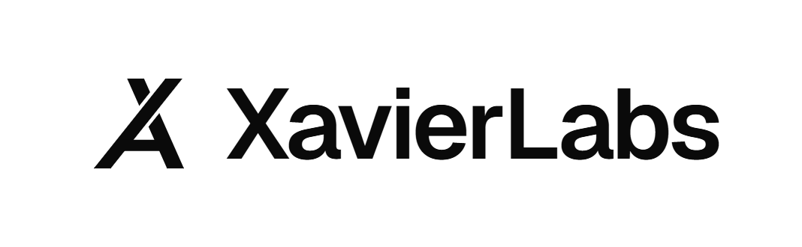
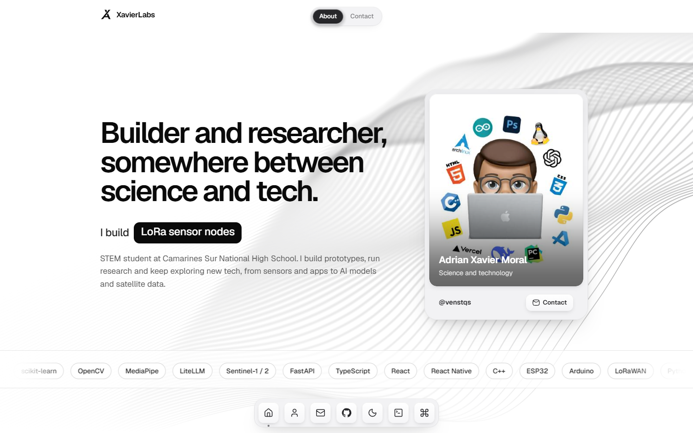
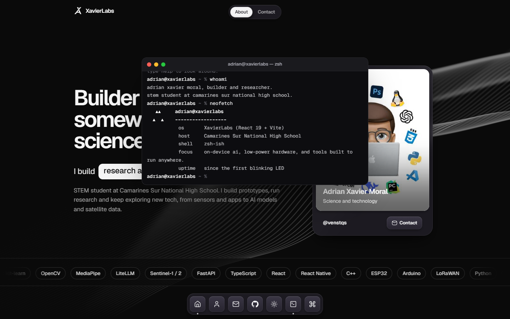

<p align="center">
  <picture>
    <source media="(prefers-color-scheme: dark)" srcset="brand/lockup-white-on-black.png">
    
  </picture>
</p>

<p align="center">
  The personal site of <b>Adrian Xavier Moral</b>: builder and researcher, somewhere between science and tech.<br>
  <a href="https://adrianfolio.vercel.app"><b>adrianfolio.vercel.app</b></a>
</p>

<p align="center">
  <picture>
    <source media="(prefers-color-scheme: dark)" srcset="docs/hero-dark.png">
    
  </picture>
</p>

## What's in it

One landing page, black and white, built to be explored with the keyboard as much as the mouse.

| | |
|---|---|
| **Terminal** | Press <kbd>`</kbd> for a draggable macOS Terminal with a tiny shell: `whoami`, `ls`, `open github`, `neofetch`, `theme`, `email`. History with <kbd>↑</kbd> <kbd>↓</kbd>. |
| **Command menu** | <kbd>Ctrl</kbd>/<kbd>⌘</kbd> <kbd>K</kbd> to jump anywhere, copy the email, switch theme or open a link. |
| **Shortcuts** | <kbd>1</kbd>–<kbd>4</kbd> sections · <kbd>T</kbd> theme · <kbd>E</kbd> copy email · <kbd>?</kbd> all shortcuts. |
| **Theme** | Light and dark, with a circular View Transitions reveal from wherever you clicked. Set before first paint, so no flash. |
| **Live GitHub** | Contribution graph and latest public activity, fetched in the browser. Fails quietly when rate-limited. |
| **Build stamp** | The footer links to the exact commit the deployed site was built from. |

<p align="center"></p>

## Stack

React 19 · Vite 8 · GSAP · Motion · lucide-react · Geist / Geist Mono

UI components from [React Bits](https://reactbits.dev), kept unmodified in `src/components/rb/`:
Threads, SplitText, RotatingText, BlurText, ProfileCard, LogoLoop, GooeyNav, Dock, ClickSpark, ScrollReveal, CircularText, Counter, GlassIcons, Folder, SpotlightCard, ScrollVelocity, TextPressure, FlowingMenu, Magnet, AnimatedContent.

## Structure

```text
brand/                  Logo kit: SVG marks, 1024px app icons, wordmark lockups
docs/                   README screenshots
public/                 Favicon, OG image, avatar
src/
  data.js               All copy: profile, socials, hero words, tools, links
  App.jsx               Nav, theme, Dock, command menu, Terminal, shortcuts
  index.css             Light/dark tokens and layout
  components/
    Hero.jsx            Headline, rotating line, ProfileCard, tools loop
    Sections.jsx        About, velocity band, Contact, Footer
    Terminal.jsx        The ` Terminal window and its commands
    Logo.jsx            A×X monogram + XavierLabs wordmark
    ui.jsx              Command menu, shortcuts sheet, contribution graph, toast
    rb/                 React Bits components
```

## The mark

An **A** and an **X** sharing one diagonal. The falling stroke passes *under* the rising one, cut where they cross, and the whole thing leans 10°. Files in [`brand/`](brand/): use the black mark on light backgrounds, the white one on dark, and leave at least half the mark's width of clear space around it.

## Develop

```bash
npm install
npm run dev       # local dev server
npm run build     # production build in dist/
npm run preview   # serve the build
```

Edit copy in [`src/data.js`](src/data.js); nothing else needs to change for content updates.

---

<p align="center"><sub>Born to inherit the stars. · © Adrian Xavier Moral</sub></p>
